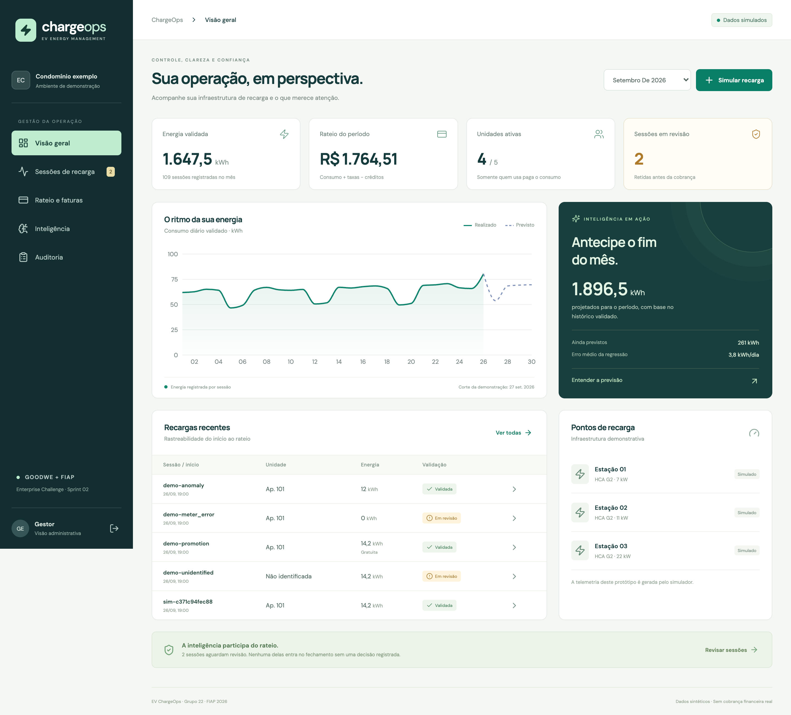
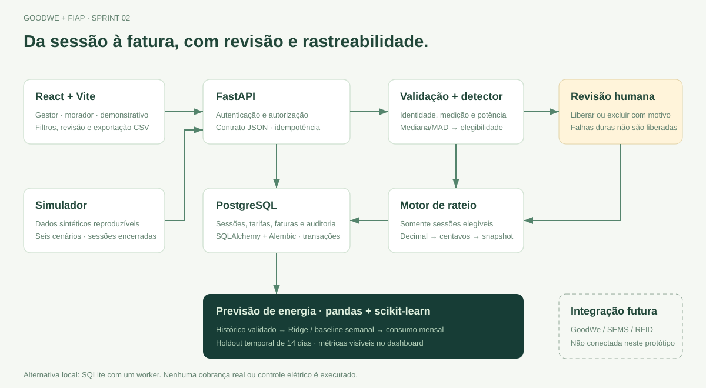

# EV ChargeOps — Sprint 02

**Sessões de recarga rastreáveis, rateio por unidade e inteligência que participa da decisão.**

Protótipo funcional do Enterprise Challenge 2026, GoodWe + FIAP. Implementa a proposta da [Sprint 01](docs/sprint-01/README.md) com API, banco relacional, dashboard do gestor e portal do morador.

**Equipe atual:** Grupo 22 — Henrique Pires Espindola, RM 568600. O Grupo 22 é o exibido na atividade da Sprint 02; o documento anterior mencionava Grupo 5 e foi preservado como histórico. A identificação do integrante permanece a mesma.



## O que funciona

- Registro de sessões com usuário, unidade, veículo, carregador, horários, medidores, energia e motivo de encerramento.
- Ingestão idempotente: repetir um mesmo evento não duplica o consumo; reutilizar seu identificador com outro conteúdo gera conflito.
- Validação de identidade, medição e potência compatível com tempo ativo.
- Rateio por kWh, taxa operacional, ociosidade, perdas, quota fixa opcional e créditos auditados.
- Recargas interrompidas cobram somente energia medida; cortesias ficam em centro promocional.
- Detector de anomalias treinado no histórico retém sessões antes da cobrança. Revisão humana exige justificativa.
- Previsão do consumo mensal com regressão, validação temporal e comparação com uma referência semanal.
- Filtros por mês, unidade, carregador, validação e tipo de encerramento; detalhamento do cálculo e exportação CSV.
- Fechamento mensal persistido e imutável, com bloqueio enquanto houver pendências.
- Login com perfis de gestor e morador. A API restringe o morador à própria unidade, inclusive no CSV.

**Todos os dados operacionais são sintéticos.** O protótipo não acessa um HCA G2 real, não movimenta dinheiro e não controla instalações elétricas. As tarifas são hipóteses didáticas. Os dados identificam o comportamento do software, não uma operação real da GoodWe.

## Executar com Docker e PostgreSQL

Pré-requisitos: Docker e Docker Compose v2. Não é necessário configurar Python, Node ou credenciais externas.

```bash
git clone https://github.com/henriquepe/ev-chargeops-sprint-02.git
cd ev-chargeops-sprint-02
docker compose up -d --build --wait
```

Abra **[http://localhost:8766](http://localhost:8766)**. A aplicação espera o PostgreSQL, aplica a migração, popula a demonstração e treina o detector. A primeira execução baixa as imagens e dependências.

| Perfil | E-mail | Senha de demonstração |
|---|---|---|
| Gestor | `gestor@demo.local` | `Demo2026!` |
| Morador do apartamento 101 | `morador101@demo.local` | `Demo2026!` |
| Outros moradores | `morador102@demo.local`, `morador201@demo.local`, `morador202@demo.local`, `morador301@demo.local` | `Demo2026!` |

As senhas são públicas porque pertencem somente à demonstração. A aplicação é vinculada a `127.0.0.1`; não publique esse ambiente com dados reais. No banco, as senhas usam scrypt e os tokens opacos são armazenados somente como hash, com validade de oito horas e revogação no logout.

```bash
docker compose ps
docker compose logs -f app
docker compose stop
```

`stop` preserva os dados. `docker compose up -d` retoma o mesmo ambiente. O seed é idempotente e não sobrescreve as decisões feitas no painel. Para reiniciar os cenários desde o início, use **outro nome de projeto e outra porta**, preservando a demonstração existente:

```bash
APP_PORT=8767 docker compose -p chargeops-demo-nova up -d --build --wait
```

## Alternativa local com SQLite

Use Python 3.13 e Node 22 (Node 20.19 também foi utilizado no desenvolvimento), com npm disponível. O SQLite facilita a avaliação sem Docker, usando os mesmos modelos, migrações, API e regras. Para concorrência entre operadores, prefira a execução com PostgreSQL.

```bash
PYTHON_BIN=python3.13 ./scripts/start.sh
```

Abra **[http://localhost:8765](http://localhost:8765)**. O script cria `.venv`, instala dependências, compila o frontend, migra e popula `backend/data/chargeops.db`. Rode na raiz do projeto. `Ctrl+C` encerra o servidor, preservando o banco.

Para desenvolvimento com atualização das telas, mantenha o backend acima rodando e, em outro terminal, execute `npm run dev --prefix frontend`. O Vite encaminha `/api` para a porta 8765. A documentação interativa da API está em `/docs`.

## Demonstrar em poucos minutos

1. Entre como **gestor** e selecione **setembro de 2026**. A base original tem 108 sessões nesse mês e três retenções. O total histórico de julho a setembro é de 356 registros.
2. Em **Simular recarga**, gere uma sessão normal. Confira o identificador, os 14,2 kWh e a validação na janela de detalhes.
3. Abra `demo-anomaly`: a duração de 650 minutos foge do histórico e a IA a retém. Escreva a justificativa e libere a cobrança ou exclua a sessão. A decisão aparece na auditoria.
4. Tente liberar `demo-meter_error` ou `demo-unidentified`: a interface impede liberar dados inconsistentes. Exclua com justificativa; uma correção deve ser importada como novo registro, preservando o original.
5. Em **Rateio e faturas**, abra **Ver cálculo**. Confira energia, operação, ociosidade, perdas e créditos separadamente. O apartamento 301 não consumiu e, com quota fixa zero, não paga.
6. Em **Inteligência**, observe o corte de treinamento, o erro da regressão e o da referência semanal.
7. Depois de resolver todas as retenções, feche o mês e exporte o CSV. Para ensaiar o fechamento sem mexer em setembro, agosto também está disponível.
8. Saia e entre como **morador**. Somente as sessões e o demonstrativo do apartamento autenticado ficam disponíveis.

Ao modificar a demonstração, os totais mudam. As capturas e relatórios registram o estado na hora em que foram produzidos.

## Arquitetura implementada



```text
Simulador ou JSON normalizado → FastAPI → validação → detector treinado
                                                   ↓
                           revisão humana ← sessão retida
                                                   ↓
                          sessão elegível → rateio → fatura/CSV
                                                   ↓
                            histórico validado → previsão → dashboard
```

- **FastAPI:** contratos Pydantic, autorização por perfil e endpoints de domínio.
- **SQLAlchemy + Alembic:** 12 tabelas de domínio mais tabela de versão de migração; chaves estrangeiras, unicidade de sessão e fatura por mês/unidade.
- **PostgreSQL:** execução principal do Compose, com travas por período e por sessão na revisão. SQLite: alternativa local com um worker, sem promessa de concorrência equivalente.
- **React + Vite + Recharts:** interface, filtros, gráficos, revisão, demonstrativos e portal. Os dados vêm da API; os cartões não são valores fixos no frontend.
- **NumPy/pandas/scikit-learn/joblib:** preparação do histórico, detector robusto, regressão e artefato de modelo.
- **Auditoria:** eventos persistidos na mesma transação que ingestões, revisões, alterações de tarifa, créditos e fechamento. É rastreabilidade de aplicação, não um registro inviolável contra um administrador do banco.

O schema completo está em [models.py](backend/app/models.py) e na [migração inicial](backend/migrations/versions/1814b67da20a_cria_dominio_de_recarga_rateio_e_.py). O payload original e seu hash permanecem associados à sessão. Não há exclusão física de sessões pela API.

## Rateio e casos de borda

```text
energia = medidor_final − medidor_inicial
energia_R$ = energia × tarifa_kWh
ociosidade_R$ = max(0, minutos_ociosos − franquia) × taxa_minuto
perdas_R$ = energia_R$ × percentual_perdas / 100
sessao_R$ = energia_R$ + taxa_operacional + ociosidade_R$ + perdas_R$
unidade_R$ = soma(sessões elegíveis) + quota_fixa − créditos
```

Cada componente é calculado com `Decimal`, arredondado em centavos com `ROUND_HALF_UP` e depois somado. O JSON monetário usa inteiros em centavos, evitando ponto flutuante na cobrança.

**Exemplo verificável:** 14,2 kWh × R$ 0,95 = R$ 13,49; operação R$ 1,50; perdas de 2% = R$ 0,27; dez minutos ociosos dentro da franquia de quinze não geram taxa. Total: **R$ 15,26**. O teste executa esse cálculo.

- A competência é o mês do **início em America/Sao_Paulo**. Sessões que atravessam meses não são fracionadas nesta versão.
- O tempo ativo é duração total menos ociosidade. A potência média ativa não pode exceder 105% da nominal; a margem de 5% é uma hipótese de validação do protótipo.
- Energia declarada, quando fornecida, deve concordar com a diferença de medidores dentro de 0,01 kWh. Um medidor regressivo ou incompatível gera retenção; o payload bruto preserva a inconsistência.
- Sessões interrompidas mantêm a energia entregue e as taxas da regra do mês. Baixo consumo/duração decorrente da interrupção não é, sozinho, anomalia estatística.
- Identificação ausente ou incompatível e falhas de medição **não podem ser aprovadas**. Devem ser excluídas e, se houver dados corretos, reimportadas com outro identificador.
- Uma unidade pode ter dois veículos; ambos consolidam no mesmo demonstrativo. Cortesias têm todos os componentes da sessão zerados, sem redistribuir esse custo aos moradores.
- A quota fixa opcional aplica-se a todas as unidades, inclusive às sem recarga, somente quando configurada. O padrão é zero.
- Créditos exigem motivo e chave idempotente. Um saldo negativo indica crédito da unidade; não dispara transferência financeira.
- O fechamento bloqueia se houver qualquer sessão pendente, inclusive sem unidade. Depois dele, sessões, créditos, regras e revisões do período são bloqueados. Repetir um fechamento concluído retorna seu snapshot. Requisições concorrentes podem receber 409 e devem consultar novamente o estado.

## Por que a IA é estrutural

### Detecção de anomalias

O detector aprende **mediana e dispersão robusta** de energia, duração, potência média ativa e ociosidade em 248 sessões anteriores a 01/09/2026. Usa:

```text
escala = max(1,4826 × MAD, piso_da_variável)
z = |valor − mediana| / escala
reter se algum z > 4,5
```

MAD é a mediana dos desvios absolutos em relação à mediana. Os pisos `[2 kWh, 20 min, 1 kW, 10 min]` evitam divisão por zero e alertas por variações irrelevantes. O limiar 4,5 é uma escolha didática, não um valor calibrado em operação real. Para interrupções, desvios negativos de energia e duração são esperados e não retêm por si só.

A inferência acontece na ingestão e define `eligibility=pending`. O motor de rateio só inclui `eligible`; o fechamento recusa pendências. Uma aprovação humana pode liberar uma anomalia estatística, mas não ignorar falhas duras de identificação/medição. Modelo, score, explicação, decisão e ator ficam registrados.

Com menos de 30 sessões, o detector informa `insufficient_history` e as regras de qualidade continuam ativas. Importações anteriores ao corte recebem `historical_import`, sem uma pontuação que usasse seu próprio futuro. O modelo está congelado após o seed; não é retreinado silenciosamente ao aprovar uma anomalia.

### Previsão mensal

Consumo diário validado, incluindo dias de consumo zero, alimenta uma **regressão Ridge** com tendência e dia da semana. O sistema reserva os últimos 14 dias para validação, compara MAE com a média por dia da semana e seleciona o menor erro. Só depois reajusta o modelo escolhido com todo o histórico disponível até o corte para prever os dias restantes.

Na base original, a regressão apresentou **MAE de aproximadamente 2,70 kWh/dia**; os números completos, datas e baseline estão no [relatório executado](docs/evidencias/postgresql.json). A demonstração usa corte em **27/09/2026**, considerando sessões encerradas antes desse dia. A seleção de meses anteriores limita o corte ao fim daquele mês. Sem 35 dias de observação, a API retorna insuficiência de histórico.

A projeção é a energia validada já observada mais a energia diária prevista até o último dia do mês. Não prevê potência simultânea, não aciona balanceamento elétrico e não apresenta intervalo de confiança que não tenha sido estimado. Sessões retidas/excluídas ficam fora da série. Dados sintéticos comprovam a execução do método e não seu desempenho em campo.

## Decisões e desvios em relação à Sprint 01

| Plano anterior | Implementação e justificativa |
|---|---|
| FastAPI, PostgreSQL, SQLAlchemy/Alembic | Mantidos; SQLite acrescentado para facilitar execução sem Docker |
| React/Vite ou Next.js | Escolhido React/Vite: uma API e uma interface local bastam para o protótipo |
| Integração real GoodWe/SEMS quando houver acesso | Sem conta ou dados reais fornecidos; implementado o fallback simulado previsto e o contrato normalizado de importação. Não há adaptador SEMS homologado |
| Fila/event log e telemetria periódica | Log transacional e importação da sessão encerrada; sem broker nem streaming, evitando infraestrutura sem necessidade demonstrada |
| Usuário/RFID e veículo | Login e usuário/unidade/veículo implementados; leitor RFID e associação física de tags ficam para a integração de hardware |
| Previsão e anomalias como prioridades | Ambas implementadas. Detector robusto foi escolhido entre as opções previstas por ser explicável com pouca massa histórica; regressão Ridge para previsão |
| Chatbot/RAG e clustering opcionais | Não implementados: o foco foi completar o ciclo de cobrança e IA prioritária |
| Cadastro completo de entidades | Usuários, unidades, veículos e carregadores são populados pela demonstração; API de consulta e relacionamento, sem telas de CRUD administrativo |
| OAuth futuro | Login simples com perfis, hash de senha e token revogável; sem provedor externo |
| Estornos | Créditos pré-fechamento auditados; reabertura, notas de ajuste e estornos pós-fechamento ficam fora do MVP |

Para conectar o laboratório, ainda será necessário obter autorização/conta, confirmar protocolo e campos reais, mapear RFID, sincronizar horários, tratar retentativas e testar contra o equipamento. O contrato de entrada está em [SessionInput](backend/app/schemas.py). A referência de hardware da primeira fase não é prova de que uma API real foi integrada.

## Testes e evidências

**Revalidação de 09/10/2026:** instalação nova, testes, API, banco e interface conferidos novamente. Consulte o [relatório de aceite atualizado](docs/evidencias/revalidacao-2026-10-09/RELATORIO.md), incluindo a correção da duração do pitch para cinco minutos.

```bash
./scripts/check.sh
```

A suíte cobre cálculo decimal, promoção, interrupção, créditos, ociosidade, identificação, potência, idempotência, timezone, fechamento, autorização e ausência de dados futuros na previsão. Testes de componentes verificam retenção visível, abertura do detalhe e resultados vazios.

Para executar o fluxo completo contra o servidor **PostgreSQL real**:

```bash
docker compose exec -T app python - --base http://127.0.0.1:8000 --month 2026-10 --output /tmp/evidence < scripts/evidence.py
docker compose cp app:/tmp/evidence.json ./evidence.json
```

Esse roteiro cria seis sessões de teste, resolve retenções, verifica dois revisores concorrentes, aplica crédito, fecha uma fatura de **R$ 29,26** e verifica acesso do morador. Ele fecha o mês escolhido; para repetir no mesmo banco, escolha outro mês ainda aberto, por exemplo `--month 2026-11`, ou uma nova instância Compose.

- [Resultado e roteiro da validação](docs/evidencias/VALIDACAO.md)
- [Log da suíte e do build](docs/evidencias/testes.txt)
- [Execução HTTP PostgreSQL — JSON](docs/evidencias/postgresql.json) e [HTML](docs/evidencias/postgresql.html)
- [Execução HTTP SQLite — JSON](docs/evidencias/sqlite.json) e [HTML](docs/evidencias/sqlite.html)
- [Fatura do morador](docs/evidencias/04-fatura-morador.png) e [portal mobile](docs/evidencias/05-portal-mobile.png)
- [Captura de revisão pela IA](docs/evidencias/03-revisao-ia.png)
- [Guia de estudo e decisões de código](docs/GUIA_DE_ESTUDO.md)
- [Roteiro para o pitch de cinco minutos](docs/PITCH_5_MINUTOS.md)
- [Entendimento e rastreabilidade da rubrica](CRITERIOS_E_PLANO.md)

O workflow GitHub Actions executa testes backend, frontend e fluxo HTTP com PostgreSQL em ambiente novo.

## Organização

```text
backend/app/       contratos, autenticação, domínio, rateio, IA, simulador e API
backend/migrations/ schema versionado
backend/tests/     testes de regra, integração e autorização
frontend/src/      componentes React, cliente HTTP, estilos e testes
scripts/           execução local, verificações e evidência HTTP
Dockerfile         build da interface e execução da API
compose.yaml       aplicação + PostgreSQL, com volumes e healthchecks
docs/sprint-01/    pesquisa original preservada
docs/evidencias/   capturas e saídas reais de validação
entrega.txt        link do repositório para anexar ao FIAP ON
```

## Autoria, estudo e entrega

O desenvolvimento contou com apoio de IA para implementação e revisão. Os testes, decisões e limitações estão documentados para leitura crítica. A equipe deve estudar e conseguir explicar o código; este repositório não comprova sozinho a compreensão individual exigida pela instituição. O guia e o pitch são materiais de preparação.

O arquivo `entrega.txt` é o formato solicitado pela atividade. A entrega no FIAP ON e a gravação/apresentação individual do pitch são etapas distintas. Conforme o enunciado consultado, o prazo da Sprint 02 é **13/10/2026, às 23h59**, e a validação presencial é necessária para habilitar as notas. Na releitura do enunciado em **09/10/2026**, o pitch individual consta como **cinco minutos**; essa orientação substitui os três minutos registrados em setembro.

## Referências técnicas

Consultadas em 27/09/2026. A pesquisa de contexto e suas fontes permanecem na documentação da Sprint 01.

- [FastAPI — segurança e autenticação](https://fastapi.tiangolo.com/tutorial/security/oauth2-jwt/): referência de autenticação; aqui optamos por tokens opacos revogáveis, não JWT.
- [SQLAlchemy — ORM Quick Start](https://docs.sqlalchemy.org/en/20/orm/quickstart.html).
- [scikit-learn — Ridge](https://scikit-learn.org/stable/modules/generated/sklearn.linear_model.Ridge.html).
- [scikit-learn — detecção de novidades e outliers](https://scikit-learn.org/stable/modules/outlier_detection.html): distinção entre aprender referência histórica e avaliar novas observações.
- [NIST — detecção de outliers](https://www.itl.nist.gov/div898/handbook/eda/section3/eda35h.htm): dispersão robusta e MAD.
