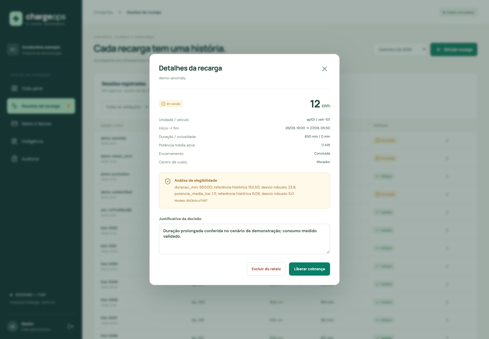
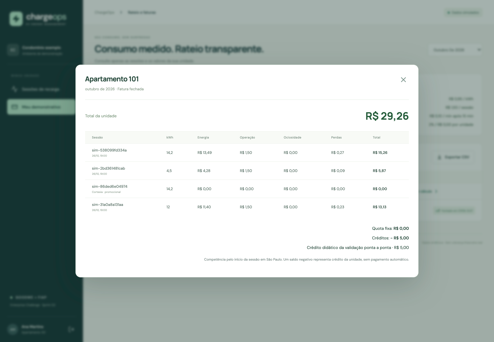

# Validação executada — 27/09/2026

Todas as sessões e contas operacionais são sintéticas. Os resultados abaixo vieram da aplicação em execução, não de telas com valores estáticos. Não houve teste com equipamento GoodWe real nem cobrança financeira.

## Resultado

| Camada | Execução | Resultado |
|---|---|---|
| Backend | pytest, SQLite isolado por teste | **31 testes passaram** |
| Frontend | Vitest + Testing Library | **3 testes passaram** |
| Qualidade e build | Ruff + Vite | **passaram** |
| API e persistência | HTTP contra FastAPI + PostgreSQL 17 no Docker | **15 verificações passaram** |
| Alternativa local | HTTP contra FastAPI + SQLite | **15 verificações passaram** |
| Interface | Chrome real, desktop 1440 px e emulação mobile 400 px | fluxos descritos abaixo conferidos |

O [log da suíte](testes.txt) registra os comandos de verificação. Há um aviso de depreciação do adaptador HTTPX do TestClient, sem falha de execução. As dependências estão fixadas no projeto.

## Fluxo HTTP reproduzível

O script [evidence.py](../../scripts/evidence.py) autentica, cria recargas normal, interrompida, gratuita, atípica, sem identificação e com medidor regressivo. Verifica retenções, rejeição de aprovação de dados inconsistentes, revisão, crédito, repetição idempotente, fechamento, imutabilidade e autorização do morador, inclusive no CSV.

No PostgreSQL, duas requisições de revisão concorrentes retornaram **200 e 409**: apenas uma decisão foi gravada. Essa garantia depende das travas do PostgreSQL; a alternativa SQLite é executada com um worker.

A conta esperada foi comprovada em ambos:

| Item | Valor |
|---|---:|
| Normal — 14,2 kWh | R$ 15,26 |
| Interrompida — 4,5 kWh | R$ 5,87 |
| Cortesia — 14,2 kWh | R$ 0,00 |
| Anomalia revisada — 12 kWh | R$ 13,13 |
| Crédito | − R$ 5,00 |
| **Total fechado** | **R$ 29,26** |

Registros completos, com horários, versões do modelo, sessões, métricas e demonstrativo:

- PostgreSQL: [JSON](postgresql.json) · [relatório HTML](postgresql.html).
- SQLite: [JSON](sqlite.json) · [relatório HTML](sqlite.html).

Abra os arquivos HTML localmente para uma leitura formatada. As execuções fecharam outubro de 2026. A competência futura é intencional no cenário sintético para preservar setembro como demonstração; não representa consumo real ocorrido. Para repetir, use outro mês aberto ou uma nova instância, conforme o README.

## Validação manual no Chrome

1. Login como gestor e conferência do dashboard alimentado pela API.
2. Simulação de uma sessão normal: 14,2 kWh, validação automática e atualização dos totais.
3. Abertura de `demo-anomaly`: duração de 650 minutos, score robusto e justificativa do modelo visíveis. Registro de justificativa humana, liberação e redução do número de pendências.
4. Tentativa de fechar setembro com duas pendências restantes: interface bloqueou o fechamento e explicou a necessidade de revisão.
5. Conferência da tela Inteligência: treino, holdout temporal, MAE da regressão e da referência semanal, projeção e limites da demonstração.
6. Logout e login como morador do apartamento 101: navegação restrita a sessões e demonstrativo da própria unidade.
7. Seleção de outubro: fatura fechada de R$ 29,26 e abertura de Ver cálculo, com cada componente e crédito.
8. Emulação em 400 px: navegação, demonstrativo, tabela com rolagem horizontal e botão de saída acessíveis. Logout retornou ao formulário de login.

### Capturas reais

[Portal em tela mobile](05-portal-mobile.png).

O dashboard foi capturado depois de uma recarga e uma revisão manual; por isso seus totais diferem da base original e do relatório PostgreSQL. A previsão usa somente sessões encerradas antes do corte e pode diferir do total de sessões elegíveis exibido nos cartões. Os modelos foram treinados em instâncias separadas e seus identificadores de versão são registrados em cada evidência.

## O que permanece fora desta validação

- Integração SEMS/Modbus, RFID e leitura de carregador físico.
- Calibração e qualidade preditiva em dados reais, teste de carga de produção e auditoria de segurança externa.
- Gravação/apresentação individual do pitch e envio na plataforma FIAP: estes materiais preparam essas etapas, mas não as substituem.

## Reproduzir

Siga a instalação do [README](../../README.md). Execute `./scripts/check.sh` para os testes e o comando de `scripts/evidence.py` para o fluxo HTTP. O workflow em [validate.yml](../../.github/workflows/validate.yml) repete as verificações em ambiente novo a cada push.
