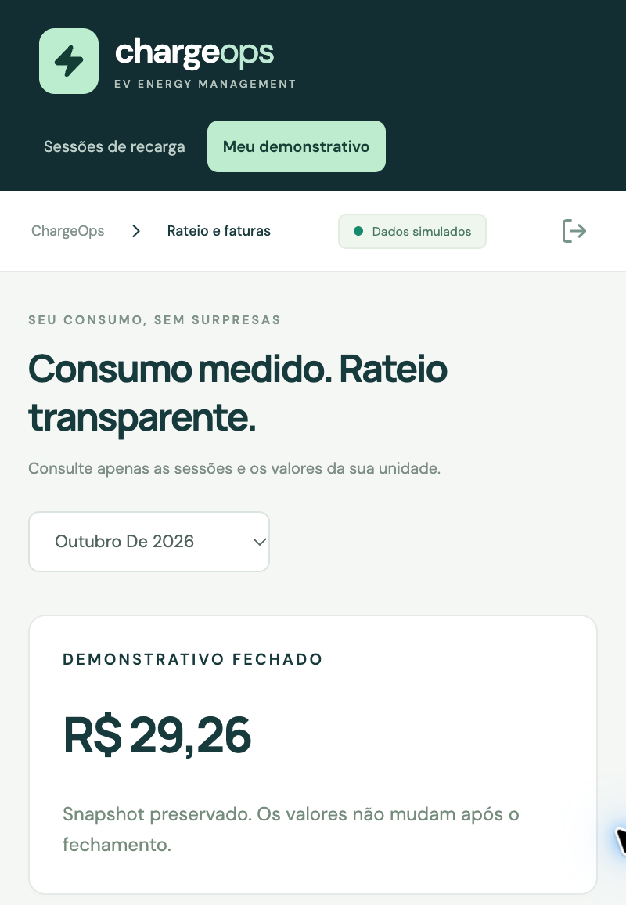

# Revalidação dos critérios de aceite — 09/10/2026

**Veredito:** os requisitos técnicos e documentais da entrega digital estão atendidos após as correções desta revisão. O TXT está pronto para envio. O domínio individual do código e a apresentação presencial precisam ser demonstrados pelo aluno; a verificação automatizada não permite marcar esse critério como cumprido nem garantir pontuação.

**Fonte:** [atividade FIAP ON 662437](https://on.fiap.com.br/mod/assign/view.php?id=662437&returnto=conteudocurso), relida no Chrome em 09/10/2026. A plataforma exibia **entrega pendente**, Grupo 22, prazo **13/10/2026 às 23h59**. Nenhum arquivo foi enviado ao FIAP ON nesta revalidação.

## Mudança encontrada no enunciado

A duração atual do pitch individual é **cinco minutos**, gravado durante a prova presencial obrigatória agendada. Os três minutos registrados em setembro ficaram desatualizados. O [roteiro de cinco minutos](../../PITCH_5_MINUTOS.md), o README e o plano foram corrigidos; o link antigo direciona ao roteiro atual. A primeira fase permanece preservada como documento histórico.

## Matriz de aceite

| Exigência | Resultado | Evidência |
|---|---|---|
| Lógica central da Sprint 01: sessões, consumo individual e rateio — 3 pontos | Atendido tecnicamente | Testes de domínio, fluxo HTTP e confirmação das linhas no banco |
| Interrupção, gratuidade, crédito, ociosidade, ausência de consumo, dois veículos e quota opcional | Atendido | Suíte backend e caso adicional de ociosidade |
| IA com papel estrutural — 3 pontos | Atendido tecnicamente | Detector treinado retém sessões; revisão altera elegibilidade/cobrança; previsão com corte temporal e baseline |
| Evidências de funcionamento — 2 pontos | Atendido | Capturas, JSON/HTML de execução, logs de testes e persistência |
| Autoria e compreensão da equipe — 1 ponto | Depende da demonstração individual | Guia de estudo e decisões documentados; é necessário explicar o código e apresentar o pitch |
| README atualizado e repositório organizado — 1 ponto | Atendido tecnicamente | README em português, execução validada, arquitetura, limites, desvios e commits descritivos |
| TXT contendo o link correto | Pronto | `entrega.txt` aponta para o repositório público da Sprint 02 |
| Envio no FIAP ON | Pendente | A atividade ainda exibia entrega pendente; envio não realizado nesta revisão |
| Pitch presencial individual | Pendente de realização/comprovação pelo aluno | Enunciado atual exige cinco minutos e condiciona a validação das notas à etapa presencial |

A coluna de peso reproduz os critérios da rubrica; não representa nota atribuída por esta revisão. O professor avalia a qualidade, autoria e aderência da solução.

## Ambiente e resultados reproduzidos

Foi feito um clone novo do repositório público, base `cbd1ec27cddb32ff76fad8d6a6967710078d9183`, fora da instalação anterior. Foram reinstaladas as dependências, construído o frontend e inicializados bancos novos. O Compose utilizou PostgreSQL 17; a execução alternativa utilizou SQLite. Nenhuma alteração em regras de domínio ou código da aplicação foi necessária.

| Verificação | Resultado |
|---|---|
| Ruff | Passou |
| Backend pytest | 31 testes passaram |
| Frontend Vitest | 3 testes passaram |
| Build Vite | Passou |
| Docker Compose: build, migração, seed e healthchecks | Passou |
| Fluxo HTTP com PostgreSQL | 15 verificações passaram |
| Fluxo HTTP com SQLite | 15 verificações passaram |
| Caso adicional de ociosidade acima da franquia | Passou: 20 − 15 minutos = R$ 0,50; sessão total R$ 15,76 |
| Consulta direta ao PostgreSQL | 5 faturas, 4 itens, R$ 34,26 brutos, crédito R$ 5,00, total R$ 29,26; 1 evento de fechamento |
| Consulta direta ao SQLite | Fatura persistida e revisão feita no navegador confirmadas no banco e na auditoria |
| Dependências npm após correção | Zero vulnerabilidades reportadas pelo npm audit |

As duas chamadas concorrentes de revisão no PostgreSQL retornaram 200 e 409, preservando uma única decisão. A repetição do fechamento manteve o snapshot; novas sessões após o fechamento foram rejeitadas. O morador acessou somente sua unidade e não recebeu acesso à auditoria administrativa.

### Correção pontual de dependência

O npm reportou vulnerabilidade em `source-map-js@1.2.1`, dependência de desenvolvimento transitiva de Vite/PostCSS. O lockfile foi atualizado somente para `1.2.2`, versão corrigida indicada no [aviso GHSA-68fv-2mgg-jv7q](https://github.com/advisories/GHSA-68fv-2mgg-jv7q). Testes de componentes, build e instalação Docker foram repetidos com o lockfile atualizado. O problema se refere ao processamento de source maps; não foi observado comprometimento do protótipo.

## Conferência pela interface real

No Chrome, sobre a instalação SQLite nova:

1. Login do gestor: dashboard com 108 sessões em setembro, 1.621,3 kWh, R$ 1.736,12 e 3 retenções.
2. Simulação normal: sessão `sim-12ea453b0347`, 14,2 kWh, estado validado e explicação do modelo.
3. Revisão de `demo-anomaly`: motivo estatístico visível, botões bloqueados sem justificativa, aprovação com motivo, aviso de auditoria e redução das pendências de 3 para 2.
4. Filtro do apartamento 301: zero registros e mensagem de estado vazio.
5. Rateio após simulação/revisão: R$ 1.764,51; tentativa de fechamento bloqueada por duas pendências.
6. Inteligência: 248 sessões de referência, treino e validação separados, MAE da regressão e baseline e projeção visíveis.
7. Logout e login do morador 101: somente navegação e dados da própria unidade; mensagem informa que a revisão depende do gestor.
8. Outubro: demonstrativo fechado de R$ 29,26, abertura da composição com quatro sessões e crédito de R$ 5,00.

O mês futuro de outubro foi utilizado apenas como cenário sintético para preservar setembro aberto. Os relatórios HTTP capturam a base antes das interações manuais; seus totais podem diferir da tela após novas sessões/revisões.

## Higiene e limites da conferência

- Não foram encontrados 5xx ou stack traces nos logs dos fluxos exercitados.
- Não houve exceção JavaScript da aplicação nos fluxos. O DevTools mostrou um 404 para `/favicon.ico`, um detalhe visual sem impacto no funcionamento ou no aceite acadêmico.
- O pytest manteve o aviso de depreciação do adaptador HTTPX do TestClient, sem falha.
- Não foi feita comparação contra Figma nem repetida a matriz mobile: não há mudança de UI; as evidências mobile anteriores continuam em `docs/evidencias/`.
- Não há ambiente de staging ou equipamento GoodWe fornecido. A implantação local isolada e o GitHub Actions são as verificações de instalação; não comprovam operação física, homologação ou desempenho preditivo real.
- Datas do histórico e corte da previsão são fixos para uma demonstração reproduzível; não são telemetria ao vivo de outubro.

## Arquivos de evidência

- [Testes backend](testes-backend.txt) e [frontend/build](testes-frontend.txt).
- PostgreSQL: [JSON](postgresql.json), [HTML](postgresql.html), [consulta SQL](postgresql-persistencia.txt) e [log do servidor](servidor-postgresql.txt).
- SQLite: [JSON](sqlite.json), [HTML](sqlite.html) e [consulta ao banco](sqlite-persistencia.json).
- [Ociosidade acima da franquia](ociosidade.json).
- [Auditoria npm após correção](npm-audit.json).

Para reproduzir, siga os comandos do README. O script `scripts/evidence.py` fecha o mês escolhido; use uma base nova ou outro mês aberto ao repetir. O repositório inclui workflow que valida backend, frontend e fluxo PostgreSQL a cada push.

### Disponibilidade das imagens no CI

A execução de 09/10 no GitHub passou em backend e frontend, mas o job PostgreSQL inicialmente parou antes de construir a aplicação: o Docker Hub respondeu `toomanyrequests` ao baixar sua imagem. A repetição confirmou o limite externo. O workflow passou a consultar o [cache público de imagens mantido pelo Google](https://docs.cloud.google.com/artifact-registry/docs/pull-cached-dockerhub-images), com fallback padrão para o Docker Hub. A configuração se aplica somente ao runner temporário do GitHub. Os testes com PostgreSQL já haviam passado na instalação local nova; a situação atual da execução remota pode ser consultada na aba Actions do repositório.
